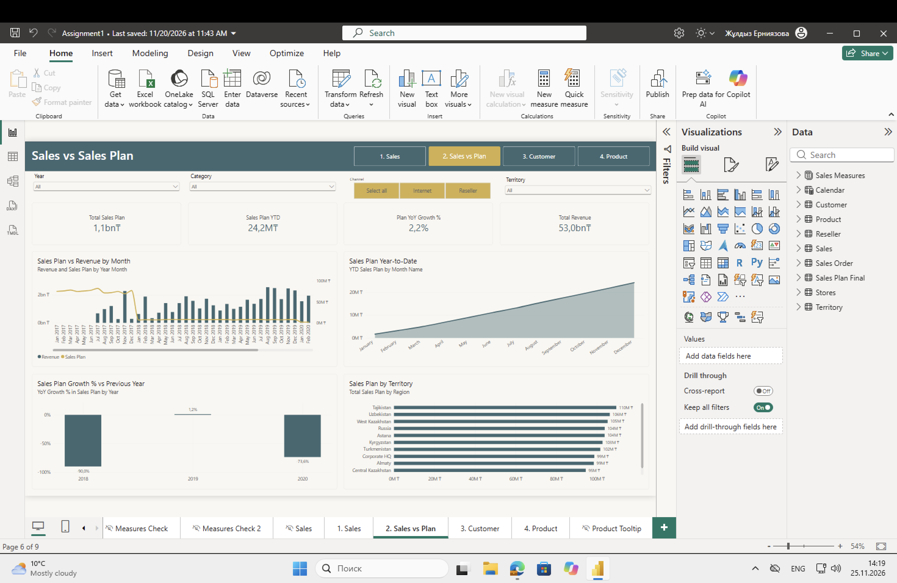
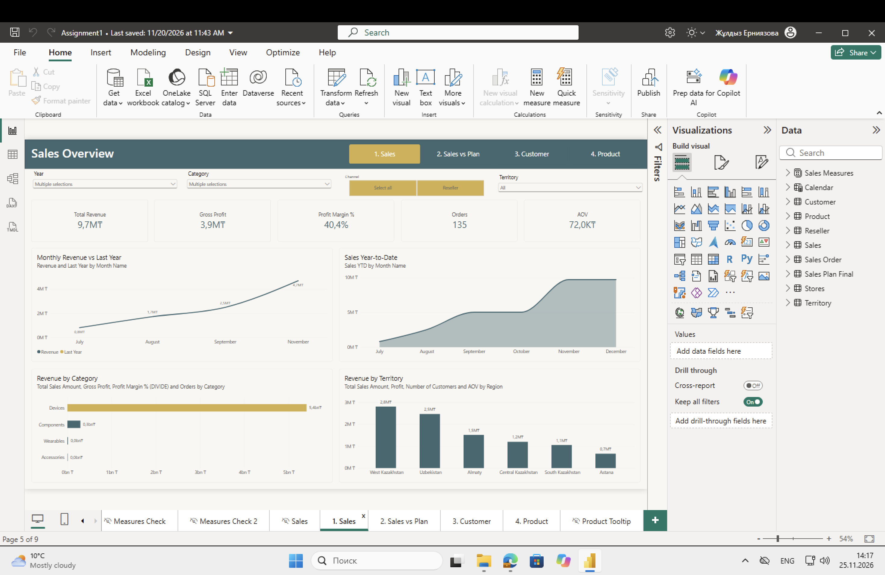
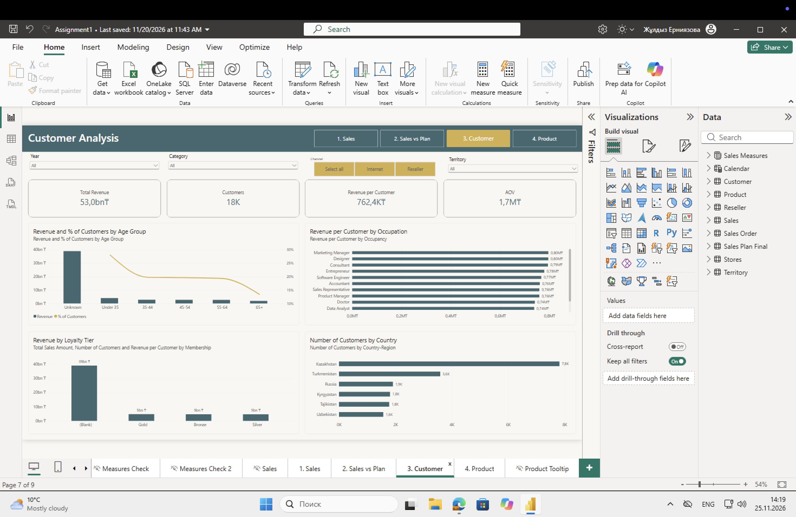
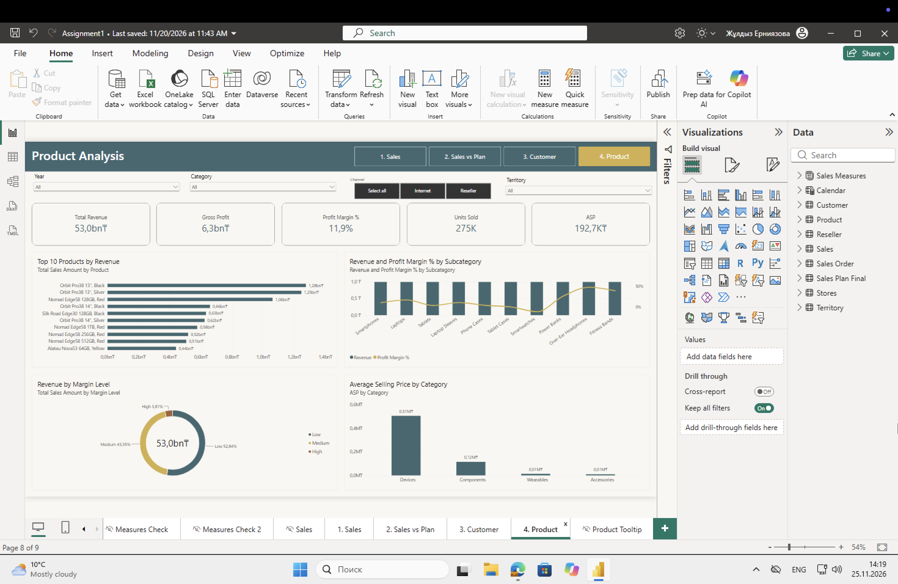
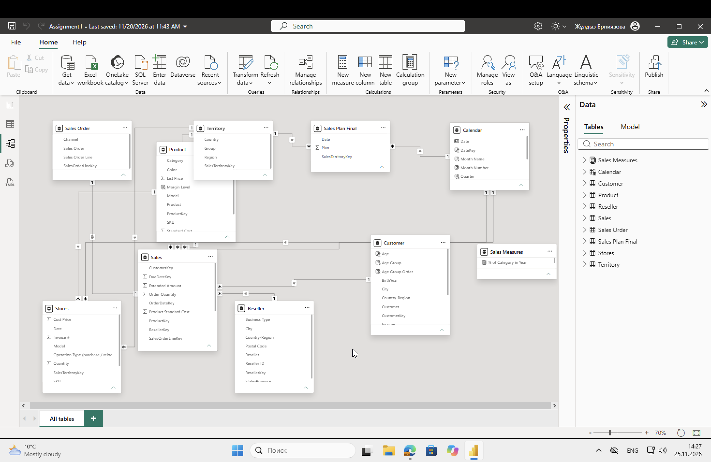

# Sales Performance Analysis — Power BI

An interactive 4-page Power BI report analysing sales, plan, customers and products for an electronics retailer operating in Kazakhstan and Central Asia (amounts in tenge, ₸).



## Business questions

- How are revenue, profit and margin developing over time (YTD, vs last year)?
- How does actual revenue compare with the sales plan, by month and territory?
- Who are our customers — by age group, occupation, loyalty tier and country?
- Which products and categories drive revenue, and how profitable are they?

## Key insights

- **Revenue of 53.0 bn ₸ and gross profit of 6.3 bn ₸** (profit margin 11.9%) from 275K units sold to ~18K customers.
- **More than half of revenue (52.8%) comes from low-margin products**, while high-margin products bring only 3.8%. That is the main lever for improving profitability.
- **Devices are the core of the business.** Their average selling price (0.51M ₸) is about 4× higher than Components (0.12M ₸). The top 2 products, Orbit Pro38 13" in Black and Silver, bring in ~1.3 bn ₸ each.
- **About 74% of revenue (39 bn ₸) comes from customers outside the loyalty program.** Gold, Silver and Bronze members bring ~5 bn ₸ each, so there is room to grow program membership.
- **Kazakhstan is the largest market**, with 7.8K customers (~43%), followed by Turkmenistan (3.6K) and Russia (1.9K).
- **Revenue per customer is stable across occupations** (0.74–0.80M ₸ each), so occupation is not a strong segmentation factor.
- **The sales plan is spread almost evenly across territories** (95–110M ₸ each), even though actual revenue is concentrated in West Kazakhstan and Uzbekistan.

## Report pages

| Page | What it shows |
|------|---------------|
| **1. Sales** | Revenue, gross profit, margin %, orders, AOV; monthly revenue vs last year, Sales YTD, revenue by category and territory |
| **2. Sales vs Plan** | Total plan, plan YTD, plan YoY growth; plan vs revenue by month, plan by territory |
| **3. Customer** | Customers, revenue per customer, AOV; breakdown by age group, occupation, loyalty tier and country |
| **4. Product** | Units sold, ASP, top 10 products, revenue and margin by subcategory, revenue by margin level, ASP by category |

All pages share synced slicers (Year, Category, Channel, Territory) and navigation buttons. A custom **tooltip page** shows product details on hover.

| Sales vs Plan | Customer | Product |
|---|---|---|
|  |  |  |

## Data model

Star schema with one fact table and shared dimensions:

- **Fact:** `Sales` (order lines: quantity, price, cost)
- **Dimensions:** `Calendar`, `Product`, `Customer`, `Reseller`, `Territory`, `Sales Order`
- **Additional facts:** `Sales Plan Final` (monthly plan by territory) and `Stores` (store purchases and relocations, combined from a folder of CSV files)
- **Measure table:** `Sales Measures`



## Skills demonstrated

**Power Query**
- Importing from Excel workbooks and combining multiple CSV files from a folder
- Cleaning, type conversion, merging plan data from several sources

**Data modelling**
- Star schema, one-to-many relationships, dedicated `Calendar` table with a date key
- Calculated columns: Season, Quarter, Year-Month (with sort column), Age and Age Group, Unit Margin % and Margin Level (Low / Medium / High)

**DAX**: 30+ measures, including:
- Core KPIs: `Total Sales Amount`, `Profit`, `Profit Margin %`, `AOV`, `ASP`, `Revenue per Customer`
- Time intelligence: `TOTALYTD`, `TOTALQTD`, `SAMEPERIODLASTYEAR`, `PREVIOUSMONTH` (YTD, PY, YoY %, MoM %)
- Plan analysis: `Sales Plan Achievement %`, `YTD Sales Plan`, `YoY Growth % in Sales Plan`
- Context manipulation: `CALCULATE` with filters, `ALL`, `RANKX`, share of total

```dax
YoY Growth % =
DIVIDE ( [Total Sales Amount] - [Sales PY], [Sales PY] )

Category Rank =
IF (
    HASONEVALUE ( Product[Category] ),
    RANKX ( ALL ( Product[Category] ), [Total Sales Amount], , DESC )
)

Margin Level =
SWITCH (
    TRUE (),
    Product[Unit Margin %] < 0.4, "Low",
    Product[Unit Margin %] < 0.5, "Medium",
    "High"
)
```

**Visualisation and UX**
- KPI cards, combo charts (bars + line on a secondary axis), area, donut and bar charts
- Page navigation buttons, synced slicers, custom tooltip page, consistent colour theme

## How to open

1. Install [Power BI Desktop](https://powerbi.microsoft.com/desktop/).
2. Clone or download this repository.
3. Open `Assignment1.pbip`.
4. The source files were loaded from a local folder. To refresh the data, update the file paths in **Transform data → Data source settings**.

## Tools

Power BI Desktop · Power Query (M) · DAX · PBIP / TMDL format for version control
